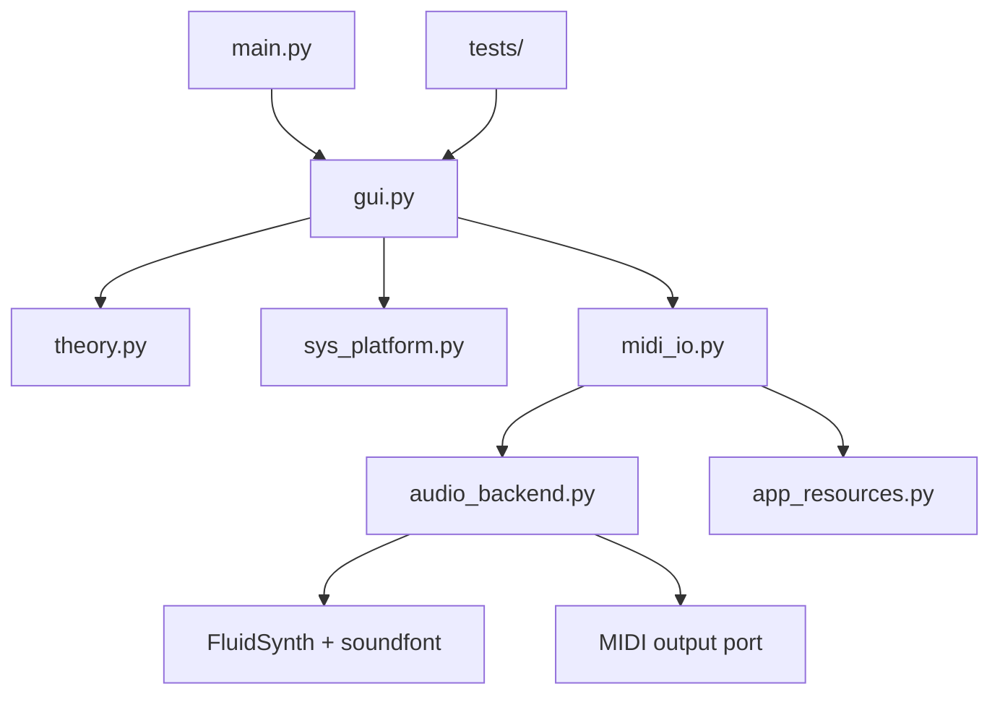
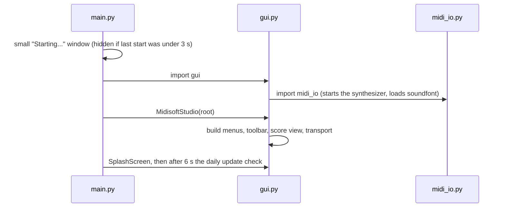
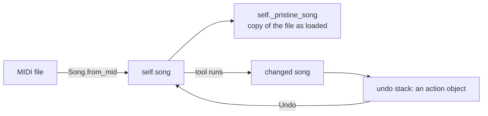
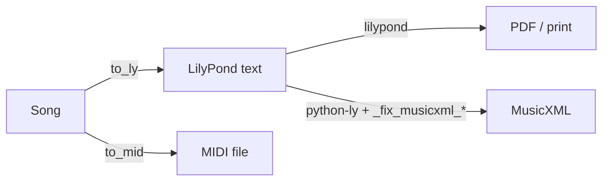

# Maintaining MIDI Studio

For whoever opens this code next (including its author, a year from now). It says where things are, how the
pieces connect, and which rules must not be broken. It describes build 22ze-300 (0.4.1 ready to release). Line numbers
drift with every patch, so find things by name: `grep -n "def _auto_correct_run" gui.py`.

If this file and the code disagree, the code is right; please fix this file.

## 1. The rules that matter most

These come from what the program promises its users. Break one and a user's music is damaged.

1. **Repair tools change the written score only.** The original sound is kept. Anything that changes how the
   piece *sounds* must be optional and off by default.
2. **Strikes per bar must not change** after any action the user did not choose. Remove Short Rests changes
   note lengths only.
3. **Undo restores.** Every tool that changes the song pushes an action on the undo stack (section 5).
4. **Be honest about what is untested.** The User Guide and the About text say plainly what has and has not
   been checked (Mac, MidiSoft Studio, hand and finger suggestions can be impossible).
5. **Fingering Numbers are on/off only** and start Off for every file that is loaded (`_load_file_inner`).
6. **Hand separation, Easy to Play and Fingering are suggestions.** They are worked out from the notes alone
   and can give hands or fingers that cannot be played. The text is in `_EXPERT_CHECK` and in the guide.

## 2. Repository map

| Path | What it is |
|---|---|
| `main.py` | Entry point. Shows "Starting..." window, then imports `gui` (slow: loads the sounds). |
| `gui.py` | **The program.** About 24,000 lines: data model, score drawing, playback transport, all dialogs. |
| `midi_io.py` | Chooses and starts the sound output (FluidSynth or a MIDI port); MIDI input dispatch. |
| `audio_backend.py` | The single place all output goes through (`send`, volume, shutdown). |
| `app_resources.py` | Finds files shipped inside the app: bundled FluidSynth library and soundfont. |
| `sys_platform.py` | Version numbers, settings file, update check, soundfont search. |
| `theory.py` | Constants: instrument names, note names, key signatures. |
| `tests/` | Unit tests (`python3 -m unittest discover -s tests`). |
| `docs/` | `USER_GUIDE.md`, the PDF built from it, `LINUX_FROM_SOURCE.md`, `dev/build_user_guide.py`, this file. |
| `packaging/{linux,windows,macos}` | Build scripts for the downloads. |
| `.github/workflows/` | `tests`, `lint`, `windows`, `linux`, `macos`, `release`. |

Per-user files the program writes: `~/.midistudio_settings.json` (settings), `~/.midi_studio_load_seconds`
(whether to show the Starting window), `~/.midistudio_logs/` (problem-report logs, can be switched off).

## 3. How the modules connect

Start-up, in order:

## 4. Where things are in gui.py

Order in the file (top to bottom). Use `grep -n "^class \|^def " gui.py` for the live list.

| Area | Names to look for |
|---|---|
| Window tidy and logging helpers | `_tidy_work_window*`, `_tlog*`, `_wrap_messagebox` |
| Custom menus | `TkPopupMenu`, `TkMenuBar` (menu items accept `tooltip=`) |
| LilyPond finding and names | `_find_lilypond`, `_ly_*` |
| MusicXML repair after python-ly | `_fix_musicxml_*`, `_add_musicxml_velocity` |
| Staff and key helpers | `pitch_to_staff`, `detect_key_signature`, `_find_split_pitch_for_track` |
| Suggestions (marks, soft notes) | `_suggest_marks`, `_soft_notes`, `_auto_dynamic_marks` |
| `remove_short_rests` | the Remove Short Rests engine; uses `_strike_slots` to guard strike counts |
| **Data model** | `MidiNote`, `MidiEvent`, `Track`, `Song` (see section 5) |
| `Transport` | the playback thread (section 6) |
| Views | `PianoRollView`, `MidiListView`, `TracksView`, `MixerView`, `QuantizeDlg` |
| `ScoreView` | the score canvas: `_draw_inner`, `_draw_system`, `_draw_chords`, `_draw_beams`, click handling |
| Fingering | `_fing_step_cost`, `_fing_sequence`, `_hand_tracks_for_fingers`, `_fingering_cached` |
| Undo actions | `RationalizationAction`, `NoteEditAction`, `ThinAction`, `TimeScaleAction`, `CalibrationAction`, `SongSwapAction` |
| `MidisoftStudio` | the application object: menus (`_build_menu`), load/save, every tool's dialog and `_..._run` |

Tools and where their code starts (all methods of `MidisoftStudio` unless noted):

| Menu item | Start here |
|---|---|
| Auto-Correct Score | `_auto_correct_score` then `_auto_correct_run` |
| Separate Hands / Fix Chords | `_ask_separate_hands_options` then `_separate_hands` |
| Remove Short Rests | `_remove_short_rests_dialog` then `_remove_short_rests_apply` (engine `remove_short_rests`) |
| Easy to Play | `_easy_play` |
| Fingering Numbers | `_fingering_dialog`, mode in `self._finger_mode` and `_FINGER_MODE_LY` |
| Suggest Marks / Soft Notes | `_suggest_marks_dialog`, `_soft_notes_dialog` |
| Compare with Original | `_show_compare` (uses `self._pristine_song`) |
| Listening speed | `_set_listening_speed` |
| Where do I find... | `_where_dialog` (list of label, keywords, guide anchor) |
| Open User Guide | `_open_user_guide(anchor)` |
| About | `_about` |

## 5. The data model and Undo

- `Song` holds `tracks`; each `Track` holds `notes` (`MidiNote`: tick, pitch, duration, velocity).
- The **sound** is the notes' own ticks and velocities. The **written score** is what `to_ly()` and the
  `ScoreView` draw from. Repair tools are built to change the second without the first
  (`rationalize_keep_audio`).
- `self._pristine_song` is a deep copy made when a file is loaded. Compare with Original uses it.
- `self._undo_stack` / `self._redo_stack` hold action objects. `_undo` is one long chain of `isinstance`
  tests, one per action class. **Adding a tool that changes the song means adding an action class and a branch
  in both `_undo` and `_redo`** (a missing redo branch once made Redo do nothing, fixed in 266c).
- Auto-Correct runs several repairs under one undo step so one Undo puts everything back.
- Fingering and hand results are cached by `id(note)` in `_fingering_cached`; reset when the song changes.

## 6. Playing, drawing, exporting

**Playing.** `Transport` runs a thread (`_run_body`) that walks the song by time (tempo map included) and calls
`_send(msg)`, which goes to `midi_io` and then `audio_backend`. Listening speed changes the clock only, not
the song.

**Drawing the score.** `ScoreView._draw` redraws everything: staves per system, then chords, beams, rests,
ties, dynamics, pedal. Because it redraws all, a tool should change the song, then call
`app._refresh_views()`.

**Printing and exporting.**

MusicXML does not come from a writer of our own: it is python-ly fed our LilyPond text, then corrected by the
`_fix_musicxml_*` functions (ties, chords, octave shifts, velocity). If MuseScore shows wrong notes, look at
those first. The MusicXML export has been tested with MuseScore only.

## 7. Tests and CI

- `python3 -m unittest discover -s tests` expects `OK (skipped=4)` (some tests need a display or sound).
- `tests.yml` runs on Ubuntu (real check) plus macOS and Windows (advisory). `lint.yml` (black, isort, flake8,
  pylint) is **advisory**: its steps are `continue-on-error`, so a red lint step does not mean the build is bad.
- The tests import `gui` itself, so they test the classes the program really uses. Where `gui` cannot be
  imported (no display, no sound libraries) they skip instead of failing.

## 8. Releasing

1. Work on a patch, test twice on a fresh copy and run the unit tests (section 10).
2. Set `APP_RELEASE` in `sys_platform.py` to the release number (no "-dev"); commit and push; wait for Tests
   to be green.
3. Run `release_tag.sh vX.Y.Z` (kept outside this repo, in the maintainer's `GITHUB-CONTROLS` folder). It
   is a dry run until you add `--go`. It checks the build status, then pushes the tag.
4. The tag starts `release.yml`, which builds Windows, Linux and Mac and creates the release page.
   `publish` needs Windows and Linux to succeed; a failed Mac build does not hold the release back.
5. Check the page: every download, the PDF, the notes text.
6. After a release set `APP_RELEASE` back to `X.Y.Z-dev`.
   Before step 2, rebuild the PDF (`python3 docs/dev/build_user_guide.py`) so its subtitle and footer carry the release number.

Lessons from 0.4.0:

- A workflow called by `release.yml` that asks for `contents: write` needs the caller to allow it, even if
  that job is skipped on tags. Otherwise the whole release workflow is "invalid" and nothing starts.
- In the notes heredoc in `release.yml`, backticks run as shell commands. Do not use them there.
- Windows builds are not code-signed, so Windows shows "unknown publisher". Mac needs a one-time approval.

## 9. History: removed code

Until build 22ze-268 the repository also held `synth.py` and `export.py`, older copies of classes now living in
`gui.py` that the program never imported (so edits to them did nothing, and the tests were testing them rather
than the real `Song`). Build 22ze-269 removed them, with seven functions nothing called (`spacer_seq`,
`Transport._s2t`, `ScoreView._draw_note`, `ScoreView._apply_duration_to_selection`, `_thin_two_hand_tracks`,
`MidisoftStudio._song_settings`, `SongSettingsDlg`). If you find an old note that mentions them, it is out of
date. To see them: `git checkout v0.4.0 -- synth.py export.py`.

## 10. Patching, and the User Guide

The maintainer's patch routine (one small script per change):

- Run from the repo root: `python3 patch_NAME.py`. It replaces exact text and checks each replacement is found
  exactly the stated number of times; otherwise it prints `REFUSED` and changes nothing.
- It is safe to run twice ("Already applied. Nothing changed."), keeps CRLF line ends, runs `py_compile` and
  bumps `APP_VERSION` and `APP_TIMESTAMP` in `sys_platform.py`.
- Test on a fresh copy twice, then run the unit tests. Commit named files only (`git add <files>`, never
  `git add .`).
- Send the guide PDF as `MIDI-Studio-User-Guide-vNNN.pdf` (the number is the build) and copy it over
  `docs/MIDI-Studio-User-Guide.pdf` when applying, so downloads never collide. `build_user_guide.py` stamps the
  subtitle and page footer from `sys_platform.py` (APP_RELEASE and the build number).

**User Guide.** Source is `docs/USER_GUIDE.md`; `docs/dev/build_user_guide.py` makes the PDF (needs pandoc and
Playwright). `_where_dialog` in `gui.py` and the guide's Index point at guide headings by anchor. **If you
rename a heading, update `_where_dialog` and the Index, or "Where do I find..." will open the wrong page.**

## 11. Adding a feature: checklist

1. Which menu? Add it in `_build_menu` (with a `tooltip=` if it is a suggestion).
2. Does it change the song? Add an action class and the `_undo` / `_redo` branches (section 5).
3. Does it change the sound? Then it must be optional and off by default (rule 1).
4. Does it change strikes per bar? It must not (rule 2); the existing tools show how `_strike_slots` is used.
5. Add a line to `_where_dialog`, a section and Index entry to the User Guide, rebuild the PDF.
6. Add a test, preferably one that imports `gui`.

## 12. Plan

### 0.4.1 (in progress)

Done: repository tidy (269-271); new fingering search from published cost rules plus textbook scale and chord shapes
(272, 273); release notes wording and User Guide fingering text (274); Afterword in the User Guide (275, 276);
copyright note in the User Guide (279); faster Score window for long pieces (280); two quick notes close together
(trills) drawn as separate notes in the Score and in print (281); an Intel Mac test build added to the Mac workflow
(282, not yet tested on a real Mac); Separate Hands sorts keyboard instruments only and asks which one when the
file has several (283); a Help button and the F1 key in 15 of the program's windows, opening the User Guide at the
right section, with a note saying where it opened, and lowering always-on-top windows so the browser can come in
front (284 to 287); scale fingering by the textbook rule, octave pairs get no finger numbers, Playing >
Octave Lines (two hands)… splits fast octave runs into the two hands as a suggestion (289 to 292); a one-track
file now says it is only drawn on two staves, with a red Caution button on the Score (293); the User Guide and its
PDF carry the build number (293); Octave Lines finds runs followed at once by a bass note, honours a Score selection
and offers runs of four or more pairs (292, 295, 299); Fix File > Quantize grid names fixed (they were off by a factor
of four) and notes snapped onto a barline keep their length (296); two quick notes in one sixteenth slot are drawn as two
(297); tablet notes (298); release preparation (300).

Decided: the hand-separation prototype (event search, physical limits and continuity only) scored 90.3 per cent
against 88.6 per cent for the current code on the development half of the PIG pieces. The gain is too small to risk
Auto-Correct, so the current hand separation stays the default in 0.4.1. A repeated-draw (bootstrap) test of the 75
development pieces put the prototype ahead by 1.8 points (sd 0.9) in nearly every draw. It will be built later as an
optional method (see below).
Tried and not shipped: tempo-aware fingering (distance over time as an extra cost). Five variants on the development
half scored 63.5 per cent at best against 63.4 per cent for the shipped scale rule, and the printed fingering looked
worse. Not built.
Ideas tried and dropped: reusing the earlier fingering for repeated figures (pianists vary about as often as the
program does); splitting repeated chords between the hands (changes the printed staves; not wanted).

To do:
- One final measurement on the held-out even-numbered PIG pieces (run once; report how many variants were tried).
- Fingering: scales are right for the right hand in C D E F G A B (two octaves, both ways) and for the left hand up in
  C D E G A and down in E. Still wrong or unchecked: left hand down in C D F G A, left hand up in F, black-key
  scales. Idea from the Revolutionary Etude: a figure repeated in a sequence should take the same fingering (the
  composer writes 4/1 patterns); an earlier chord-repeat test showed no PIG gain, so test on the Etude first.
- Check why Separate Hands put three stray notes in the right hand of the Revolutionary Etude (Octave Lines may
  already cover it).
- Undecided: a notation-only option that draws each note at the beat and keeps the real sounding length underneath, for
  performance files (a staccato note draws as a 1/32 now). Rationalize with keep-sound may already do this; check first.
- After Quantize at 1/16 about 16 per cent of starts in a performance file (chet1012) stay off the grid, because a note
  that would land on another note's slot keeps its time. Changing that rule risks splitting chords between the hands.
- Development builds: `windows.yml` and `linux.yml` each end with a `publish-dev` job that updates the rolling `dev-build`
  pre-release (public, marked untested) on every good push to main, as `macos.yml` does for `mac-test`. Link for testers:
  https://github.com/winthrom/midi-studio/releases/tag/dev-build . Not run on tags. The callers in `release.yml` allow
  `contents: write` for it; remove that line only together with the jobs.
- macOS 3.12 test job: GitHub's hosted runner was not acquired (infrastructure, not a test failure). Re-run later;
  the 3.11 and the Linux and Windows jobs passed.
- Signed Windows build (SignPath, no reply yet); Mac tests (Apple Silicon, Intel); MuseScore 4 and Braille (OSMD) checks.
- App tests by hand: start-up, About, load and score, playback, Listening speed, Auto-Correct and Undo, Where do I find, window resize.
- Help button with the browser closed (it should start the browser and show the guide), and on Windows and macOS;
  tested so far only on Linux with KDE, browser already running.
- Someone with legal training to read the copyright note in the User Guide (section 12).
- Known: floating the Score out froze one Linux machine (KDE on Wayland, with graphics-buffer errors that appear
  without the program too). Not reproduced, not filed. Leaving the Score docked avoids it.

PIG rules (agreed with Dr. Nakamura's permission): evaluation only, non-profit. Use it to choose between published
methods and as a scoreboard; never fit weights to it or copy the annotators' choices into rules; every rule names a
public source in a code comment; the data never enters the repository, tests, program or release; cite Nakamura,
Saito and Yoshii, "Statistical Learning and Estimation of Piano Fingering", Information Sciences 517 (2020), wherever
a PIG result is quoted. Odd-numbered pieces are for development, even-numbered are the untouched test half.

### 0.4.2 (planned): security and the fixes it needs

0.4.1 is tagged. 0.4.2 is the security work and any fixes it requires (decided 2026-11-19), plus steps 1 to 3 of the piano
roll plan below (decided 2026-11-21). Fixes to a patch are numbered with letters (312a, 312b ...). Remaining security work
(about 3 or 4 patches): how `midi_io.py` starts TiMidity, file-path handling, the problem-report zip, broken MIDI files.

1. **Security hardening** (first pass done 2026-11-18, code search plus reading the network and program-launch places; no
   dedicated audit yet). Found clean: no eval, exec, pickle or shell strings; programs are started with argument lists;
   no untrusted XML is read (only the program's own MusicXML is parsed); TLS checking is never turned off; zip unpacking
   uses Python's own extractor. To do:
   - DONE (v22ze-308): the Windows LilyPond download (fixed GitLab address, `_LY_DL_URL`) is checked against a pinned
     SHA-256 (`_LY_PINS`, keyed by the exact address) before anything is unpacked or run; a mismatch or an address with no
     entry is refused. The hash was computed by the maintainer on 2026-11-20 on a Linux machine (a file he downloaded
     himself; it cannot be fetched from the build container). NOT YET TRIED on Windows: run "Download and set it up for
     me" once on a real Windows machine and confirm it passes. Updating LilyPond later means a new address AND a new line
     in `_LY_PINS`, in the same commit.
   - DONE (v22ze-312): the update check opens the address from GitHub's answer only if it starts with
     `https://github.com/winthrom/midi-studio/` (`sys_platform.safe_release_url`, checked when the answer is read and
     again before the browser is opened); anything else becomes the project's releases page.
   - DONE (v22ze-312): MuseScore is looked up with `shutil.which` and started by its full path (`_musescore_paths`). On
     Windows and macOS MuseScore is usually not on the search path, so the person still gets the "open it yourself"
     instructions there; looking in the usual install folders is a possible later improvement.
   - DONE (v22ze-314): damaged MIDI files. 4,505 deliberately damaged files (truncated, corrupted bytes, lying chunk
     lengths, absurd timing values, 33 hand-made cases such as a 5-byte delta time, tempo 0, division 0, 200,000 notes
     at once) went through `Song.from_mid` and the quick checks that follow a load: no hangs, no runaway recursion; every
     failure was an ordinary exception (which the Open command already shows in a message box). One real problem: a
     header claiming to be gigantic (a 14-byte file saying "4 GB") made the MIDI library reserve that much memory.
     Now refused up front (a real header is 6 bytes), and every reading problem shows one plain sentence plus a short
     detail. NOT covered: the Score drawing, Separate Hands and Quantize on strange-but-valid files (tempo 0, division 1,
     many notes): a second, deeper round could feed those through the tools.
   - Still to review: how `midi_io.py` starts TiMidity; file-path handling on open, drag-in and export; what the problem-report
     zip contains.
   - On GitHub (maintainer, free for a public repository): switch on Dependabot alerts and CodeQL in Settings > Code security.
2. **Help with the browser closed, Linux (FIXED, v22ze-304/305, tested 2026-11-20 on two Kubuntu machines, one with snap
   Firefox).** Cause: the AppImage mounts itself under /tmp, and a snap browser cannot see that /tmp. The guide is now copied
   to ~/Documents/MIDI-Studio and a notice (shown first, then the guide opens) says so. Also fixed in 0.4.2: the
   "LilyPond Not Found" dialog on Linux and Mac now leads with the install command for the person's own system (306), and
   the Separate Hands "which instrument?" dialog had no Continue button, hidden under its button row (307; affected every
   platform since v283). Original report: On a downloaded Linux copy on Kubuntu, asking
   for the User Guide with the browser closed opened the browser, which then said there was no User Guide file in the
   temporary folder. On EndeavourOS the guide opened in a new window without trouble. Find out what differs (how the
   guide is copied to the temporary folder and how the browser is started) and fix it here. Still untested: Windows
   and macOS with the browser closed.

### 0.4.3 (planned): the command line and the rest

Decided 2026-11-21: 0.4.3 starts with steps 4 to 7 of the piano roll plan (finger numbers, reach check, stylised hand,
fingering editing on the roll with the companion file); feature 1 below (Editing fingering) is the same work as step 7.
Then the command-line mode, the Braille and tactile notes below, and the feature list after them (agreed order). Which
release carries the command line is not yet decided.

1. **Command-line mode, so a blind person can use the repairs** (accessibility). The program cannot be used with a screen
   reader today: the Score is drawn on a Tkinter canvas, so a screen reader sees no notes, and Tk's own screen-reader support
   is weak (Windows partial, Linux almost none, macOS partial; not measured here). MusicXML already gives Braille via a
   converter, but not the program's tools. Design: `midistudio check song.mid` (plain-sentence summary), `fix` (the same
   repairs as the menus, each named on the command line, suggestions off unless named; writes a new file, never changes
   the original; prints what changed in words), `read --measures 5-8` (speakable text: hand, note, length, finger),
   `export` (MusicXML; BRF music braille if a converter is found), `listen` last. Rules: every message is words, never colour or
   symbols alone; long option names and a `--help` page; no questions and no windows; exit codes say whether it worked.
   Work: pull each repair step out of the menu methods (which also open dialogs) into plain functions that the menus and the
   command line both call (this also helps the tests); a second small console `.exe` on Windows (the main one has no
   terminal); first slice `check`, `read`, `fix`, `export`. Test with one blind user and a real screen reader before
   calling it accessible. Do not design for a tactile display until a blind musician who owns one asks (see below).
2. Braille music file: look into MusicXML to music braille (BRF), for example whether MuseScore can write it, and check it on
   a real device. The NLS Braille eReader (HumanWare and Zoomax models, free to eligible US patrons through NLS) reads BRF,
   PEF, TXT, HTML, DOCX, DAISY text and PDF from an SD card or USB drive and works as a display for NVDA, JAWS and
   VoiceOver (Android over Bluetooth not supported; Linux Orca not stated). NLS BARD offers no braille music, so a BRF music
   file would fill a real gap. Whether personal files can be read from the SD card or USB is not stated outright by NLS:
   test on a real device. No Braille tester yet.
3. Tactile graphics displays (pin grids: APH/Orbit Graphiti 60 x 40, HumanWare Monarch about 96 x 40 at about 15,000
   dollars, Dot Pad X 30 x 10 cells at about 6,000 dollars): none mentions music notation. A grid this size shows a few
   measures at a time. Blue sky; waiting for a user who owns one. Nothing is to be sent to Orbit.

### Feature order for 0.4.3 and later (agreed; editing fingering is first)

1. **Editing fingering** (before lyrics: teachers will want it). Click a note, give it a finger 1 to 5; the search
   re-runs around the forced finger so the neighbours adapt. Undo covers each edit. Open question: edits live in a
   small companion file next to the MIDI file (a MIDI file has no place for fingering). The User Guide, which now
   says fingering cannot be edited, must change.
2. **Lyrics, karaoke style.** Read the lyric text events already in a file and show each syllable under its note, one
   syllable per note, with held notes for a melisma. The current syllable lights up under the red line during
   playback. Typing lyrics by hand comes later. Display only; the sound is untouched. A sung voice is not planned.
3. **Chord names.** Optional, Off by default, for songs and lead sheets, not classical works. Found from the notes by a
   published method with the lowest note giving slash chords. A suggestion: carries the "check it" note.
4. **Guitar chord boxes with capo.** Fret diagrams (strings, dots, open and muted marks, fret number) drawn from a table
   of standard shapes, with the chord name. The capo is a setting; with a capo the box shows the shape played and the
   name can show the sound. Shown on the Score, in print, in LilyPond and in MusicXML. Off by default. Needs chord names first.
5. Later and optional: staff tablature (a string and fret for every note), and a suggested capo position.

6. **Optional alternative hand method.** A choice in the Separate Hands window: the current method (default) or the
   event search (physical limits and continuity only, no fitted weights). The stretch and notes-per-hand settings apply
   to both. Arpeggio groups and held notes (already in the program) are checkboxes for the alternative; each is kept
   only if it earns its place when scored on the development pieces. Undo restores the previous split.
7. Blue sky: contributed fingerings, if the program becomes popular. Needs consent and an open licence, no automatic
   upload (the person sends the companion file), edits marked as unchecked until reviewed, and a separate decision
   on any use beyond a scoreboard or examples for an expert to review.
8. Blue sky: tablets (not planned; thinking only, 2026-11).
   - The program is a desktop Python and Tkinter program (`mido`, `python-rtmidi`, `pyfluidsynth`). It does not install on
     iPadOS or Android as it is. Samsung DeX is only an Android desktop mode (Android apps in windows on a TV or monitor);
     it does not run desktop programs, and Samsung's Linux on DeX is gone.
   - Today: remote desktop to a computer; or show exported PDF / MusicXML on the tablet.
   - Android quick test: Pydroid 3 runs Tkinter. Expect the window, the Score drawing and the repair, Separate Hands and
     fingering code to work, and `python-rtmidi` (live MIDI) and `pyfluidsynth` (sound) to fail to install. A small "no sound,
     no live MIDI" start-up mode would let the program open without them (also useful on a Linux box with no synthesizer).
     Touch use (right-click, drag-select) and the desktop window assumptions would still be rough. Termux with an X11
     add-on is possible but a real project; not for teachers.
   - Android sound: the FluidSynth MIDI Synthesizer app for Android tablets plays MIDI through SoundFont files with low
     latency and can connect to MIDI devices. A tablet version could hand its MIDI to that app instead of bundling its own
     synthesizer. Not tested; check its licence and how another app sends it MIDI before relying on it.
   - iPad: no Tkinter route (Pythonista and Pyto have their own interface kits). Remote desktop, a cloud desktop, or a real
     app. If it is ever done, a web app (logic ported or run with Pyodide, browser audio, Score redrawn in SVG) would reach iPad,
     Android, Chromebooks and desktops from one build with nothing to install. The core (MIDI reading, repair, hands, fingering,
     export) is plain Python and could be reused; the Score drawing, dialogs, sound and file handling would be new work.
   - Not before 0.4.1, fingering editing and lyrics.

### Piano roll plan (agreed 2026-11-21; steps 1 to 3 are in 0.4.2, steps 4 to 7 in 0.4.3)

What the roll does today (read from the code 2026-11-21; Undo not yet confirmed by a test): it shows ONE track in one colour
(a selected note is yellow). A click on an empty spot adds a short (1/16) note; a right-click on a note deletes it; the
toolbar has Select All, Delete, Quantize (raw ticks) and Transpose. None of these is recorded for Undo, and the User Guide
describes the roll as a way of looking only. The maintainer uses it only for viewing.

1. **View-only by default** with an "Edit notes" switch that turns on click-to-add and right-click-to-delete; every roll edit
   goes on the Undo list. (A fix: a stray click must not change the music.) Later, note editing is dropped from the roll
   and the only editing there is fingering (step 7), only while fingering numbers are shown.
2. **Hand colours**: when a file has a right-hand and a left-hand track, an optional "Show both hands" draws both, one
   colour each. Blue for the left hand and orange for the right (not red against green: about 1 man in 12 cannot tell
   those apart; blue and orange also hold up in a black-and-white print). Off by default; the Score is unchanged (the
   grand staff already shows the hands). The selected note keeps a yellow outline.
3. **Vertical view, view-only**: time runs down, the keyboard sits at the bottom, notes fall onto it while playing, keys
   light up; hand colours apply. A second way of drawing the same roll, not a second window. The roll's drawing code
   assumes time runs left to right (`_tx`, `_py`, `_xt`, `_yp`), so this redoes the drawing and the mouse handling.
4. **Finger numbers** on the roll notes and on the keys when played. Carries the "suggestion, check it" caution.
5. **Reach check**: from the finger numbers and key positions, mark notes that need a stretch beyond a comfortable reach
   for a hand-size setting, and awkward moves (thumb under, finger passing over, a hand jump faster than a hand can move
   in the time available). Marks use a shape or outline as well as colour. Reach figures need a public source named in a
   code comment. Compare with the effort cost the fingering search uses: they can disagree, which is the point (check
   what the search really measures before claiming it looks for the least difficult fingering).
6. **Stylised hand** at each strike (five fingertip dots per hand over the keys), shown only as a snapshot at each strike:
   nothing between strikes is known, so no invented in-between movement. The time between strikes is used as a computed
   measure (distance and time available). A smooth, clearly schematic glide is an optional later extra. A drawn,
   realistic hand is not planned. The picture needs the "suggestion, check it" caution because a moving hand looks authoritative.
7. **Fingering editing on the roll**, with the companion file (a MIDI file has nowhere to keep fingering; this is feature 1
   in the list below).

Estimate: about 13 to 20 patches in all (steps 1 to 3 about 5 to 9). The maintainer tests the `dev-build` after steps 1, 2
and 3. Each step also updates the User Guide and adds tests.

**Considered, not planned (2026-11-21): video to hands.** Using a video of the player (own camera over own keyboard, audio for
the notes and timing) to decide which hand played each note, and perhaps the fingers. Reasons: two heavy machine-learning
libraries (audio transcription and hand tracking), larger installers on every platform, needs a straight-down camera
angle, crossing hands confuse trackers, and Separate Hands already does well from the notes alone; typing fingerings is
covered by step 7. Scraping YouTube is out (terms of use and copyright). Reopen if teachers ask. For getting MIDI from
a recording, services such as pianotomidi.app exist (paid, closed, no API, uploads audio, we have not tested it).

### Cleanup after 0.4.2 (agreed 2026-11-21; not a feature, not security)

- **Look for dead (unused) code.** Read-only first: run `vulture` (functions and classes nothing calls) and pylint's unused
  checks (imports, variables, arguments; pylint already runs in `lint.yml`, check how strictly) over `gui.py` (about 24,000
  lines, some leftovers from earlier versions are likely) and the other files, and give the maintainer a short list of
  likely dead code. Expect false alarms in a Tk program (buttons and menus call functions by name, and tests call some
  directly), so every hit needs a human look; nothing is deleted without showing it first. This is not the same as test
  coverage (which lines the tests run): dead code is never run, but untested code is often in daily use.
- Codecov was removed in v22ze-310 (the project was never set up there, nobody read the reports). If other people start
  contributing, coverage numbers become more useful: add the step back with a Codecov token.

### Design notes (agreed, not built)

- **Printed score or performance.** A MIDI file does not say whether it was sequenced from a printed score. Plan: a question
  in the Separate Hands window, "Is this file sequenced from a printed score, where the composer's staves are the target?"
  Yes (and "Not sure", the default): keep the composer's staves; change them only when the person asks. No: the program's
  best effort leads, with levels Standard, Easier and Easiest. The levels need the optional alternative method (item 5)
  first. The effort cost would be tempo-aware (distance divided by time, squared; a physical principle, to be named in a
  code comment). Never done as part of normal Separate Hands: the composer's staves are the authority.
- **Effort flags.** First step, if wanted: mark fast octave runs and wide stretches as hard, changing no notes. An optional
  "Easy to Play" suggestion tool (an easier version to share) comes later and says it is a suggestion.
- **Help in windows.** Done for the windows that ask a question (284 to 287). Still open: the Help menu's User Guide entry
  does not show the "opening in your browser" note, and a "Where do I find" list prefilled with the window's name is only
  an idea. The Help button lowers always-on-top windows (Quantize, Rationalize Score, Score Settings) until clicked again.
- **One track, two staves.** A single-track keyboard file is drawn on two staves split at middle C, but the notes are
  still one track; Separate Hands makes a different, real split. Done (293): Fix Chords, Easy to Play, Octave Lines and
  Move to staff say so, and a red Caution button shows on the Score toolbar while the file is like that. Not done: any
  change to what Separate Hands does on load.
- **Intel Mac.** One-off build, not a release: the `intel` job in macos.yml (runner macos-15-intel) runs on branch pushes and
  uploads a zip to the rolling `mac-test` pre-release. GitHub plans to end Intel macOS runners after macOS 15 retires
  (autumn 2027). The lowest macOS the app asks for is printed in the job log (Homebrew's FluidSynth libraries may force
  Sequoia). A real release for Intel only after someone with an Intel Mac has tested it.
- **Later, if asked for:** a way to choose a non-keyboard sound number as the keyboard part (some files put the piano on
  another sound); effort-based sharing suggestions.

Scoring rule for everything above: report each result as a mean with one standard deviation and a 95 per cent range
from repeated draws of the pieces (bootstrap), and compare methods on the same draws.

Every one of these changes the written score only, keeps the sound as recorded, works with Undo, and says it is a suggestion.
