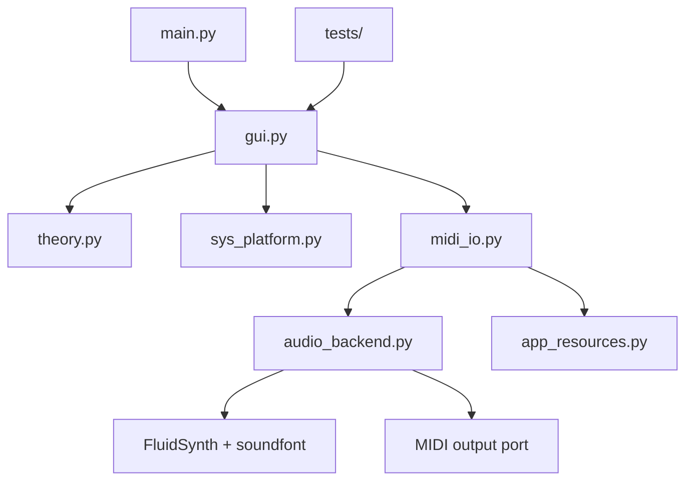
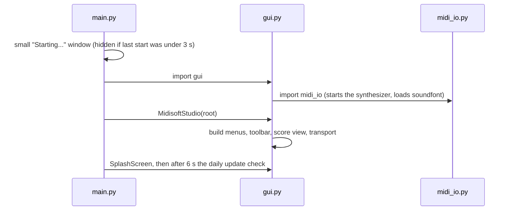
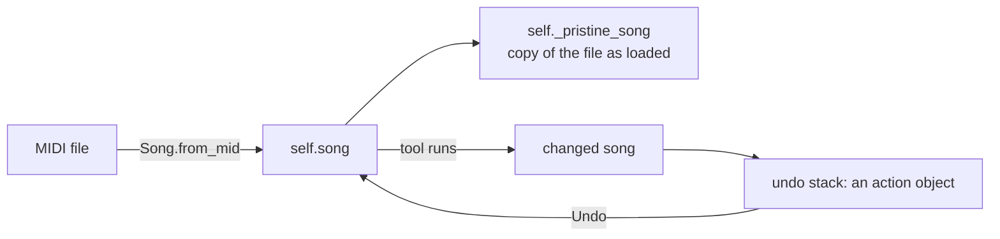
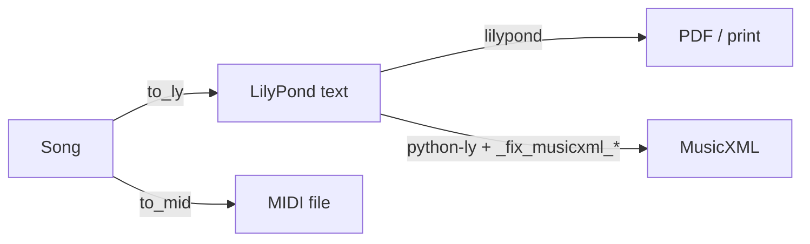

# Maintaining MIDI Studio

For whoever opens this code next (including its author, a year from now). It says where things are, how the
pieces connect, and which rules must not be broken. It describes build 22ze-269 (0.4.1 in progress). Line numbers
drift with every patch, so find things by name: `grep -n "def _auto_correct_run" gui.py`.

If this file and the code disagree, the code is right; please fix this file.

## 1. The rules that matter most

These come from what the program promises its users. Break one and a user's music is damaged.

1. **Repair tools change the written score only.** The original sound is kept. Anything that changes how the
   piece *sounds* must be optional and off by default.
2. **Strikes per bar must not change** after any action the user did not choose. Remove Short Rests changes
   note lengths only.
3. **Undo restores.** Every tool that changes the song pushes an action on the undo stack (section 5).
4. **Be honest about what is untested.** The User Guide and the About text say plainly what has and has not
   been checked (Mac, MidiSoft Studio, hand and finger suggestions can be impossible).
5. **Fingering Numbers are on/off only** and start Off for every file that is loaded (`_load_file_inner`).
6. **Hand separation, Easy to Play and Fingering are suggestions.** They are worked out from the notes alone
   and can give hands or fingers that cannot be played. The text is in `_EXPERT_CHECK` and in the guide.

## 2. Repository map

| Path | What it is |
|---|---|
| `main.py` | Entry point. Shows "Starting..." window, then imports `gui` (slow: loads the sounds). |
| `gui.py` | **The program.** About 24,000 lines: data model, score drawing, playback transport, all dialogs. |
| `midi_io.py` | Chooses and starts the sound output (FluidSynth or a MIDI port); MIDI input dispatch. |
| `audio_backend.py` | The single place all output goes through (`send`, volume, shutdown). |
| `app_resources.py` | Finds files shipped inside the app: bundled FluidSynth library and soundfont. |
| `sys_platform.py` | Version numbers, settings file, update check, soundfont search. |
| `theory.py` | Constants: instrument names, note names, key signatures. |
| `tests/` | Unit tests (`python3 -m unittest discover -s tests`). |
| `docs/` | `USER_GUIDE.md`, the PDF built from it, `LINUX_FROM_SOURCE.md`, `dev/build_user_guide.py`, this file. |
| `packaging/{linux,windows,macos}` | Build scripts for the downloads. |
| `.github/workflows/` | `tests`, `lint`, `windows`, `linux`, `macos`, `release`. |

Per-user files the program writes: `~/.midistudio_settings.json` (settings), `~/.midi_studio_load_seconds`
(whether to show the Starting window), `~/.midistudio_logs/` (problem-report logs, can be switched off).

## 3. How the modules connect

Start-up, in order:

## 4. Where things are in gui.py

Order in the file (top to bottom). Use `grep -n "^class \|^def " gui.py` for the live list.

| Area | Names to look for |
|---|---|
| Window tidy and logging helpers | `_tidy_work_window*`, `_tlog*`, `_wrap_messagebox` |
| Custom menus | `TkPopupMenu`, `TkMenuBar` (menu items accept `tooltip=`) |
| LilyPond finding and names | `_find_lilypond`, `_ly_*` |
| MusicXML repair after python-ly | `_fix_musicxml_*`, `_add_musicxml_velocity` |
| Staff and key helpers | `pitch_to_staff`, `detect_key_signature`, `_find_split_pitch_for_track` |
| Suggestions (marks, soft notes) | `_suggest_marks`, `_soft_notes`, `_auto_dynamic_marks` |
| `remove_short_rests` | the Remove Short Rests engine; uses `_strike_slots` to guard strike counts |
| **Data model** | `MidiNote`, `MidiEvent`, `Track`, `Song` (see section 5) |
| `Transport` | the playback thread (section 6) |
| Views | `PianoRollView`, `MidiListView`, `TracksView`, `MixerView`, `QuantizeDlg` |
| `ScoreView` | the score canvas: `_draw_inner`, `_draw_system`, `_draw_chords`, `_draw_beams`, click handling |
| Fingering | `_fing_step_cost`, `_fing_sequence`, `_hand_tracks_for_fingers`, `_fingering_cached` |
| Undo actions | `RationalizationAction`, `NoteEditAction`, `ThinAction`, `TimeScaleAction`, `CalibrationAction`, `SongSwapAction` |
| `MidisoftStudio` | the application object: menus (`_build_menu`), load/save, every tool's dialog and `_..._run` |

Tools and where their code starts (all methods of `MidisoftStudio` unless noted):

| Menu item | Start here |
|---|---|
| Auto-Correct Score | `_auto_correct_score` then `_auto_correct_run` |
| Separate Hands / Fix Chords | `_ask_separate_hands_options` then `_separate_hands` |
| Remove Short Rests | `_remove_short_rests_dialog` then `_remove_short_rests_apply` (engine `remove_short_rests`) |
| Easy to Play | `_easy_play` |
| Fingering Numbers | `_fingering_dialog`, mode in `self._finger_mode` and `_FINGER_MODE_LY` |
| Suggest Marks / Soft Notes | `_suggest_marks_dialog`, `_soft_notes_dialog` |
| Compare with Original | `_show_compare` (uses `self._pristine_song`) |
| Listening speed | `_set_listening_speed` |
| Where do I find... | `_where_dialog` (list of label, keywords, guide anchor) |
| Open User Guide | `_open_user_guide(anchor)` |
| About | `_about` |

## 5. The data model and Undo

- `Song` holds `tracks`; each `Track` holds `notes` (`MidiNote`: tick, pitch, duration, velocity).
- The **sound** is the notes' own ticks and velocities. The **written score** is what `to_ly()` and the
  `ScoreView` draw from. Repair tools are built to change the second without the first
  (`rationalize_keep_audio`).
- `self._pristine_song` is a deep copy made when a file is loaded. Compare with Original uses it.
- `self._undo_stack` / `self._redo_stack` hold action objects. `_undo` is one long chain of `isinstance`
  tests, one per action class. **Adding a tool that changes the song means adding an action class and a branch
  in both `_undo` and `_redo`** (a missing redo branch once made Redo do nothing, fixed in 266c).
- Auto-Correct runs several repairs under one undo step so one Undo puts everything back.
- Fingering and hand results are cached by `id(note)` in `_fingering_cached`; reset when the song changes.

## 6. Playing, drawing, exporting

**Playing.** `Transport` runs a thread (`_run_body`) that walks the song by time (tempo map included) and calls
`_send(msg)`, which goes to `midi_io` and then `audio_backend`. Listening speed changes the clock only, not
the song.

**Drawing the score.** `ScoreView._draw` redraws everything: staves per system, then chords, beams, rests,
ties, dynamics, pedal. Because it redraws all, a tool should change the song, then call
`app._refresh_views()`.

**Printing and exporting.**

MusicXML does not come from a writer of our own: it is python-ly fed our LilyPond text, then corrected by the
`_fix_musicxml_*` functions (ties, chords, octave shifts, velocity). If MuseScore shows wrong notes, look at
those first. The MusicXML export has been tested with MuseScore only.

## 7. Tests and CI

- `python3 -m unittest discover -s tests` expects `OK (skipped=4)` (some tests need a display or sound).
- `tests.yml` runs on Ubuntu (real check) plus macOS and Windows (advisory). `lint.yml` (black, isort, flake8,
  pylint) is **advisory**: its steps are `continue-on-error`, so a red lint step does not mean the build is bad.
- The tests import `gui` itself, so they test the classes the program really uses. Where `gui` cannot be
  imported (no display, no sound libraries) they skip instead of failing.

## 8. Releasing

1. Work on a patch, test twice on a fresh copy and run the unit tests (section 10).
2. Set `APP_RELEASE` in `sys_platform.py` to the release number (no "-dev"); commit and push; wait for Tests
   to be green.
3. Run `release_tag.sh vX.Y.Z` (kept outside this repo, in the maintainer's `GITHUB-CONTROLS` folder). It
   is a dry run until you add `--go`. It checks the build status, then pushes the tag.
4. The tag starts `release.yml`, which builds Windows, Linux and Mac and creates the release page.
   `publish` needs Windows and Linux to succeed; a failed Mac build does not hold the release back.
5. Check the page: every download, the PDF, the notes text.
6. After a release set `APP_RELEASE` back to `X.Y.Z-dev`.

Lessons from 0.4.0:

- A workflow called by `release.yml` that asks for `contents: write` needs the caller to allow it, even if
  that job is skipped on tags. Otherwise the whole release workflow is "invalid" and nothing starts.
- In the notes heredoc in `release.yml`, backticks run as shell commands. Do not use them there.
- Windows builds are not code-signed, so Windows shows "unknown publisher". Mac needs a one-time approval.

## 9. History: removed code

Until build 22ze-268 the repository also held `synth.py` and `export.py`, older copies of classes now living in
`gui.py` that the program never imported (so edits to them did nothing, and the tests were testing them rather
than the real `Song`). Build 22ze-269 removed them, with seven functions nothing called (`spacer_seq`,
`Transport._s2t`, `ScoreView._draw_note`, `ScoreView._apply_duration_to_selection`, `_thin_two_hand_tracks`,
`MidisoftStudio._song_settings`, `SongSettingsDlg`). If you find an old note that mentions them, it is out of
date. To see them: `git checkout v0.4.0 -- synth.py export.py`.

## 10. Patching, and the User Guide

The maintainer's patch routine (one small script per change):

- Run from the repo root: `python3 patch_NAME.py`. It replaces exact text and checks each replacement is found
  exactly the stated number of times; otherwise it prints `REFUSED` and changes nothing.
- It is safe to run twice ("Already applied. Nothing changed."), keeps CRLF line ends, runs `py_compile` and
  bumps `APP_VERSION` and `APP_TIMESTAMP` in `sys_platform.py`.
- Test on a fresh copy twice, then run the unit tests. Commit named files only (`git add <files>`, never
  `git add .`).

**User Guide.** Source is `docs/USER_GUIDE.md`; `docs/dev/build_user_guide.py` makes the PDF (needs pandoc and
Playwright). `_where_dialog` in `gui.py` and the guide's Index point at guide headings by anchor. **If you
rename a heading, update `_where_dialog` and the Index, or "Where do I find..." will open the wrong page.**

## 11. Adding a feature: checklist

1. Which menu? Add it in `_build_menu` (with a `tooltip=` if it is a suggestion).
2. Does it change the song? Add an action class and the `_undo` / `_redo` branches (section 5).
3. Does it change the sound? Then it must be optional and off by default (rule 1).
4. Does it change strikes per bar? It must not (rule 2); the existing tools show how `_strike_slots` is used.
5. Add a line to `_where_dialog`, a section and Index entry to the User Guide, rebuild the PDF.
6. Add a test, preferably one that imports `gui`.

## 12. Plan

### 0.4.1 (in progress)

Done: repository tidy (269-271); new fingering search from published cost rules plus textbook scale and chord shapes
(272, 273); release notes wording and User Guide fingering text (274); Afterword in the User Guide (275, 276).

Decided: the hand-separation prototype (event search, physical limits and continuity only) scored 90.3 per cent
against 88.6 per cent for the current code on the development half of the PIG pieces. The gain is too small to risk
Auto-Correct, so the current hand separation stays the default in 0.4.1. A repeated-draw (bootstrap) test of the 75
development pieces put the prototype ahead by 1.8 points (sd 0.9) in nearly every draw. It will be built later as an
optional method (see below).
Ideas tried and dropped: reusing the earlier fingering for repeated figures (pianists vary about as often as the
program does); splitting repeated chords between the hands (changes the printed staves; not wanted).

To do:
- One final measurement on the held-out even-numbered PIG pieces (run once; report how many variants were tried).
- Two-octave left-hand scales; fingering that knows note lengths.
- Signed Windows build (SignPath, no reply yet); Mac tests (Apple Silicon, Intel); MuseScore 4 and Braille (OSMD) checks.
- App tests by hand: start-up, About, load and score, playback, Listening speed, Auto-Correct and Undo, Where do I find, window resize.

PIG rules (agreed with Dr. Nakamura's permission): evaluation only, non-profit. Use it to choose between published
methods and as a scoreboard; never fit weights to it or copy the annotators' choices into rules; every rule names a
public source in a code comment; the data never enters the repository, tests, program or release; cite Nakamura,
Saito and Yoshii, "Statistical Learning and Estimation of Piano Fingering", Information Sciences 517 (2020), wherever
a PIG result is quoted. Odd-numbered pieces are for development, even-numbered are the untouched test half.

### After 0.4.1 (agreed order)

1. **Lyrics, karaoke style.** Read the lyric text events already in a file and show each syllable under its note, one
   syllable per note, with held notes for a melisma. The current syllable lights up under the red line during
   playback. Typing lyrics by hand comes later. Display only; the sound is untouched. A sung voice is not planned.
2. **Chord names.** Optional, Off by default, for songs and lead sheets, not classical works. Found from the notes by a
   published method with the lowest note giving slash chords. A suggestion: carries the "check it" note.
3. **Guitar chord boxes with capo.** Fret diagrams (strings, dots, open and muted marks, fret number) drawn from a table
   of standard shapes, with the chord name. The capo is a setting; with a capo the box shows the shape played and the
   name can show the sound. Shown on the Score, in print, in LilyPond and in MusicXML. Off by default. Needs chord names first.
4. Later and optional: staff tablature (a string and fret for every note), and a suggested capo position.

5. **Optional alternative hand method.** A choice in the Separate Hands window: the current method (default) or the
   event search (physical limits and continuity only, no fitted weights). The stretch and notes-per-hand settings apply
   to both. Arpeggio groups and held notes (already in the program) are checkboxes for the alternative; each is kept
   only if it earns its place when scored on the development pieces. Undo restores the previous split.
6. **Editing fingering.** Click a note, give it a finger 1 to 5; the search re-runs around the forced finger so the
   neighbours adapt. Undo covers each edit. Open question: edits live in a small companion file next to the MIDI file
   (a MIDI file has no place for fingering). The User Guide, which now says fingering cannot be edited, must change.
7. Blue sky: contributed fingerings, if the program becomes popular. Needs consent and an open licence, no automatic
   upload (the person sends the companion file), edits marked as unchecked until reviewed, and a separate decision
   on any use beyond a scoreboard or examples for an expert to review.

Scoring rule for everything above: report each result as a mean with one standard deviation and a 95 per cent range
from repeated draws of the pieces (bootstrap), and compare methods on the same draws.

Every one of these changes the written score only, keeps the sound as recorded, works with Undo, and says it is a suggestion.
